# 📡 Simulation d'un réseau mobile 2G GSM avec Atoll —  (Lomé)

## 📑 Table des matières

1. [Objectif et présentation du GSM](#1-objectif-et-présentation-du-gsm)
2. [Présentation de l'outil Atoll](#2-présentation-de-loutil-atoll)
3. [Zone d'étude](#3-zone-détude)
4. [Conception dans Atoll](#4-conception-dans-atoll)
5. [Prédictions et interprétation des résultats](#5-prédictions-et-interprétation-des-résultats)
6. [Conclusion](#6-conclusion)
7. [Références](#7-références)
8. [Liste des figures](#8-liste-des-figures)

---

## 1. Objectif et présentation du GSM

### 1.1 Objectif général

La mise en place d'un réseau 2G basé sur la norme **GSM** (*Global System for Mobile Communications*) est une étape cruciale pour fournir une couverture mobile de base dans une zone donnée. Ce projet décrit les étapes nécessaires pour **planifier, déployer et optimiser** un réseau 2G dans une zone de Lomé, à l'aide du logiciel **Atoll**, un outil de planification radio largement utilisé dans l'industrie des télécommunications.

### 1.2 La norme GSM

Le GSM est une norme de communication mobile numérique de **deuxième génération (2G)**, développée dans les années 1980 par l'**ETSI** (Institut européen des normes de télécommunications). C'est la norme la plus largement adoptée dans le monde, avec une couverture dans plus de 200 pays.

- Technologies d'accès : **TDMA** (Time Division Multiple Access) et **FDMA** (Frequency Division Multiple Access)
- Bandes principales : **900 MHz** et **1800 MHz**
- Services : appels vocaux numériques, SMS, données mobiles basiques

Les caractéristiques de la norme (prédéfinies dans les spécifications 3GPP) sont résumées ci-dessous. Elles sont exprimées en plages de valeurs car elles varient selon le milieu, l'environnement et la densité de population.

| Caractéristique | Spécificités |
|---|---|
| **Fréquences** | 850 MHz, 900 MHz, 1800 MHz, 1900 MHz |
| **Modulation** | GMSK (Gaussian Minimum Shift Keying) |
| **Débit de données** | GSM classique : 9,6 à 14,4 kbps · GPRS : jusqu'à 171,2 kbps · EDGE : jusqu'à 384 kbps |
| **Puissance d'émission** | Mobile : 2 W (900 MHz), 1 W (1800 MHz) · Station de base : jusqu'à 50 W |
| **Codage de la voix** | Full Rate (FR), Half Rate (HR), Enhanced Full Rate (EFR), Adaptive Multi-Rate (AMR) |
| **Sécurité** | Cryptage A5/1 et A5/2, authentification SIM, IMSI et TMSI |
| **Services** | Voix, SMS, USSD, GPRS (données), MMS, Roaming |

### 1.3 Pourquoi simuler un réseau mobile ?

| Avantage | Description |
|---|---|
| **Prévision des performances** | Analyse du réseau sous différentes conditions (densité de trafic, interférences, environnement) pour repérer les zones à améliorer. |
| **Optimisation des coûts** | Test de plusieurs configurations sans déployer d'équipements physiques. |
| **Planification efficace** | Définition de l'emplacement optimal des stations de base et prévision des besoins en bande passante. |
| **Identification des problèmes** | Détection en amont des problèmes de couverture, de congestion ou d'interférences. |
| **Tests de scénarios** | Évolution du trafic, pannes d'équipement, attaques de sécurité, etc. |
| **Amélioration de la QoS** | Ajustement des paramètres pour garantir la qualité de service (voix, données, multimédia). |

---

## 2. Présentation de l'outil Atoll

**Atoll** est un logiciel d'ingénierie radio conçu par **Forsk**, utilisé pour la planification, l'optimisation et la gestion des réseaux sans fil : 2G, 3G, 4G, 5G, ainsi que Wi-Fi, NB-IoT et LTE-M. Il intègre des capacités de modélisation avancée, de simulation et d'optimisation.

### Fonctionnalités principales

- **Planification des réseaux radio**
  - Conception des implantations : placement optimal des sites et antennes selon la couverture et la capacité visées
  - Analyse de la capacité : dimensionnement des cellules, y compris en forte charge
- **Optimisation des réseaux existants**
  - Réduction des interférences, ajustement des paramètres d'antennes, amélioration de la QoS
  - Intégration des données de mesures terrain (*drive tests*) pour affiner les modèles de propagation
  - Allocation automatique des fréquences
- **Simulation et prédiction**
  - Simulation de scénarios de déploiement
  - Estimation des KPI réseau (couverture, capacité, qualité)
  - Support multi-technologies (2G/3G/4G/5G, NB-IoT, LTE-M, Wi-Fi)

### Cas d'utilisation professionnels

| Public | Usages |
|---|---|
| **Opérateurs télécoms** | Maximiser la couverture, réduire les coûts d'infrastructure, améliorer la QoS |
| **Ingénieurs RF** | Dimensionner les réseaux, identifier les zones mal couvertes et les sources d'interférences |
| **Équipementiers** | Évaluer les solutions radio en scénarios simulés, préparer le déploiement de la 5G |

---

## 3. Zone d'étude

L'étude porte sur une zone délimitée du quartier **Vakpossito** (Lomé, Togo). Il s'agit d'une **zone urbaine** d'une superficie d'environ **2,91 km²**.

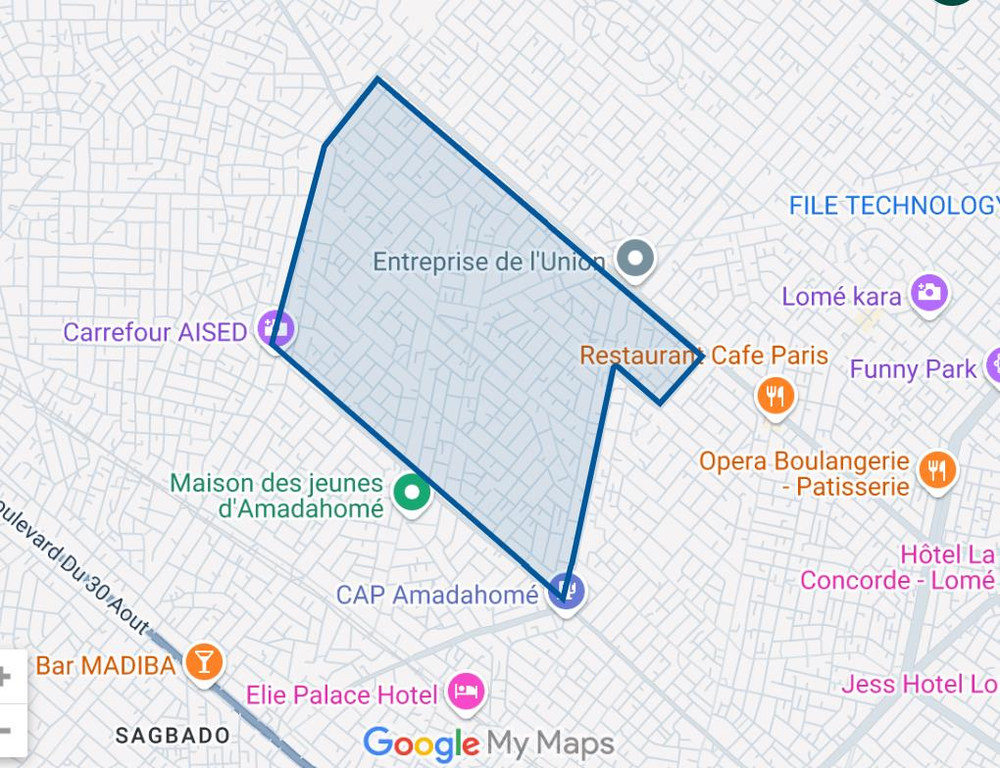
*Figure 1 — Zone d'étude délimitée sur Google My Maps*

---

## 4. Conception dans Atoll

### 4.1 Création du projet

Créer un nouveau projet à partir du modèle **« GSM GPRS EDGE »** :

**Fichier → Nouveau → À partir d'un modèle de document**

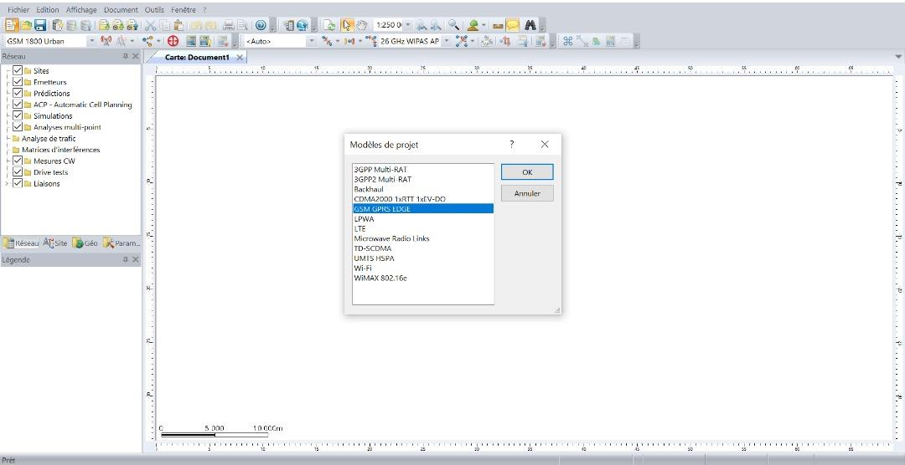
*Figure 2 — Création du projet dans Atoll*

### 4.2 Définition du système de coordonnées

Dans les propriétés du document, onglet **Coordonnées**, cliquer sur le bouton de sélection de la projection, puis choisir le système adapté à la région (sur la capture : « Lomé / UTM zone 31N », région Togo).

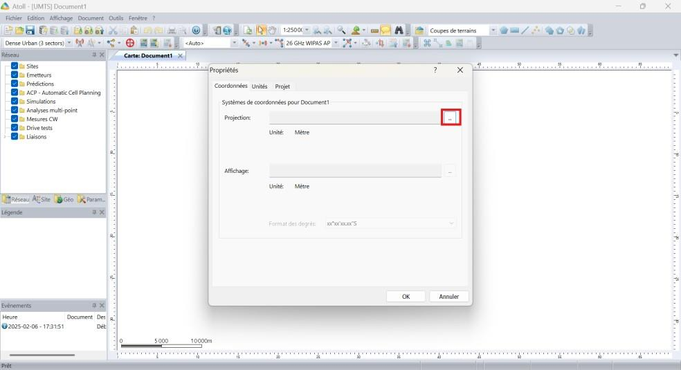
*Figure 3 — Définition du système de coordonnées (1/2)*

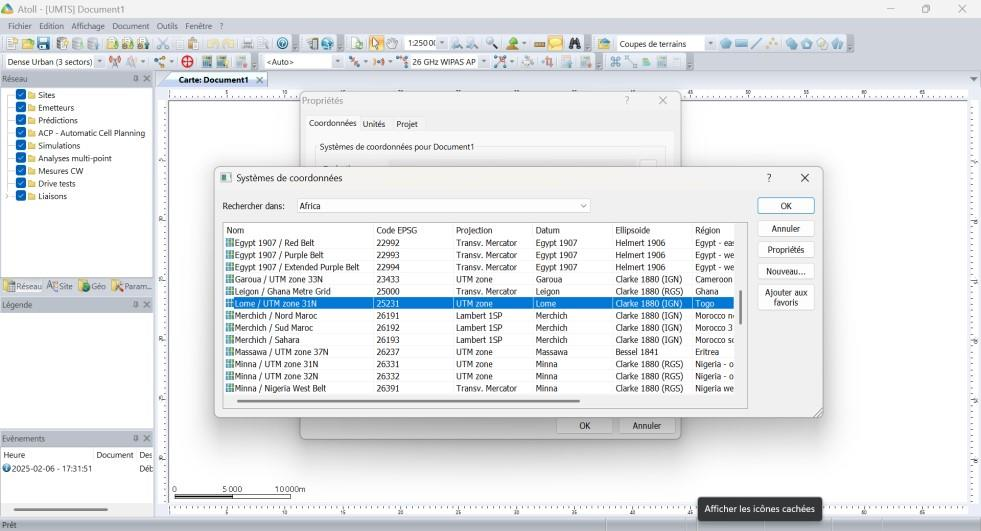
*Figure 4 — Définition du système de coordonnées (2/2)*

### 4.3 Importation de la carte

Importer une nouvelle carte qui constituera la zone de travail (clic droit sur **Cartes** → **Nouvelle carte…** dans l'onglet *Géo*).

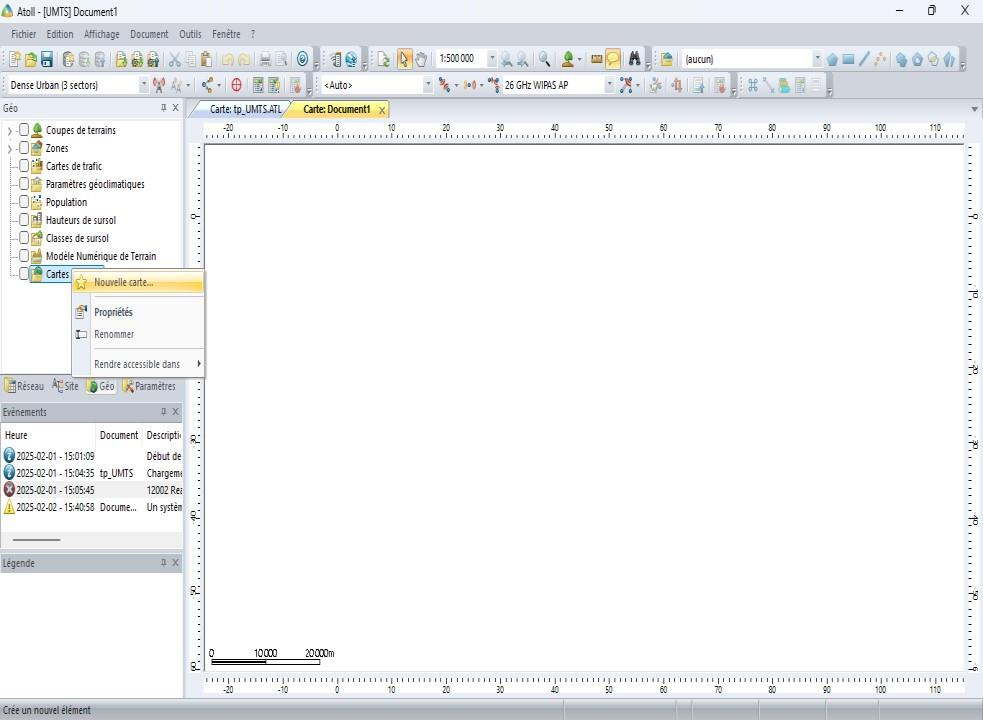
*Figure 5 — Importation de la carte (1/2)*

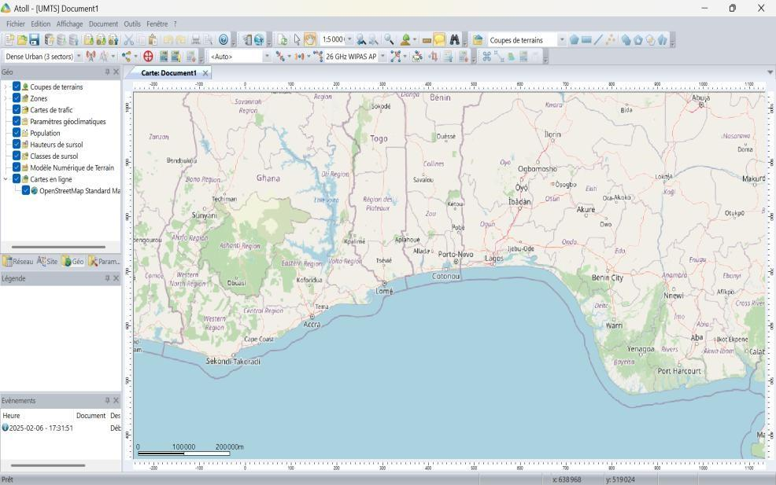
*Figure 6 — Importation de la carte (2/2) : fond OpenStreetMap*

La zone de travail est ensuite délimitée à l'aide d'une **zone de filtrage** : un filtre graphique qui limite l'affichage des objets sur la carte et dans l'explorateur de réseau à ceux situés à l'intérieur de la zone. Elle restreint également les objets utilisés dans les calculs (prédictions de couverture, etc.).

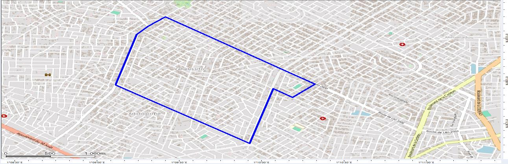
*Figure 7 — Délimitation de la zone de travail*

### 4.4 Positionnement des sites sur la carte

Les sites sont positionnés d'après des **sites physiques existants** dont les coordonnées ont été relevées sur Google Maps.

#### Paramètres retenus

| Caractéristique | Valeur |
|---|---|
| Type d'antenne | Omnidirectionnelle |
| Fréquence | 1800 MHz |
| Puissance d'émission | 46 dBm |
| Gain | 11 dBi |
| Hauteur | Site 0 : 20 m · Site 1 : 20 m |
| Nombre de sites placés | 2 |
| Nombre d'antennes par pylône | 1 |
| Azimuts | Site 0 : 0° / 0° / 327° · Site 1 : 0° / 0° / 142° |

#### Coordonnées des sites

| Site | Latitude | Longitude | Altitude (m) |
|---|---|---|---|
| **Site 0** | 6°13'8.29" N | 1°9'30.73" E | 24 |
| **Site 1** | 6°12'52.84" N | 1°9'41.68" E | 25 |

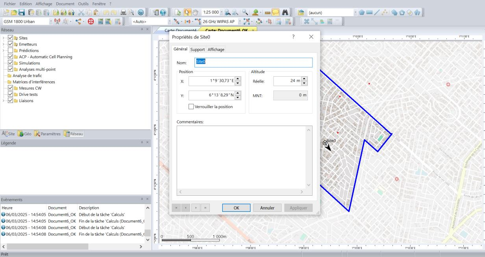
*Figure 8 — Positionnement du Site 0*

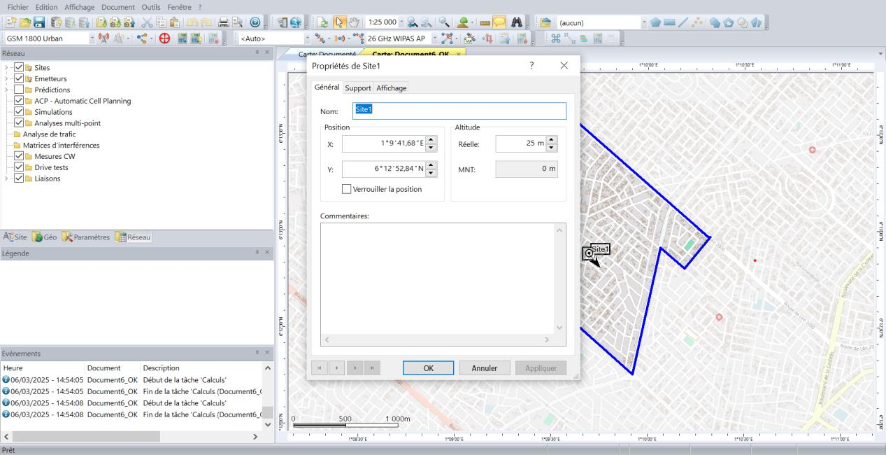
*Figure 9 — Positionnement du Site 1*

Pour chaque site, les paramètres suivants ont été définis : nom, coordonnées, et nombre de canaux en lien montant (UL) et descendant (DL), fixé à **256**.

Le type de support choisi est le **pylône tubulaire**, comme sur le site physique réel (onglet **Support**). La même configuration est appliquée au site 1.

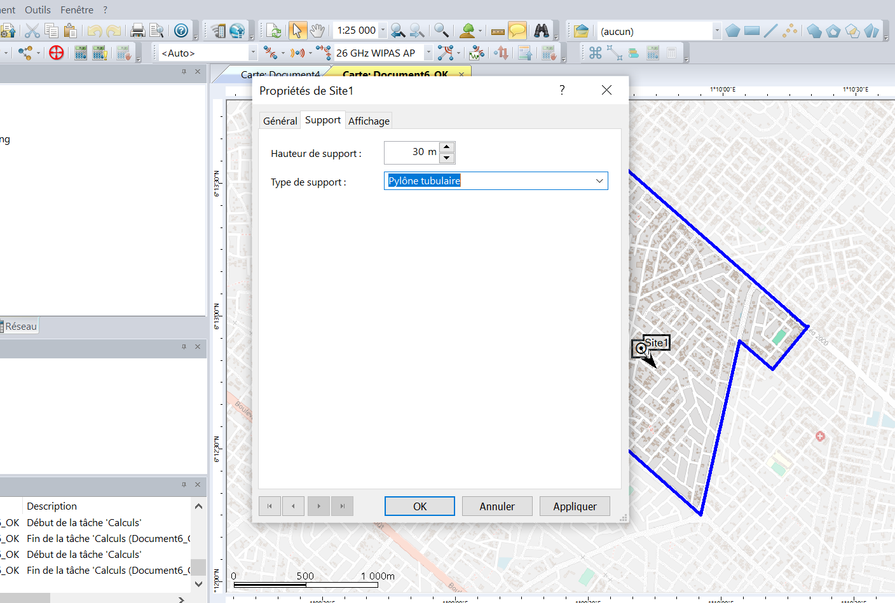
*Figure 10 — Configuration du support (hauteur et type de pylône) des sites 0 et 1*

Vue d'ensemble des deux sites positionnés sur la carte :

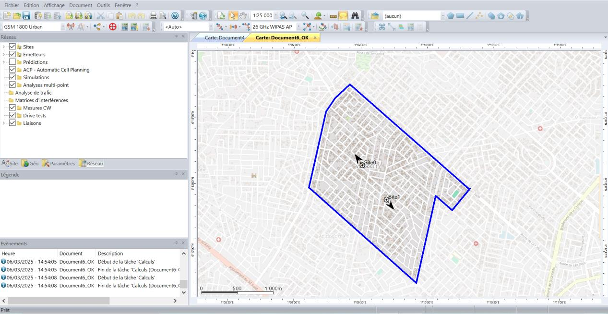
*Figure 11 — Vue définitive des sites sur la carte*

### 4.5 Configuration des antennes émettrices

Sur chaque pylône, **une antenne omnidirectionnelle** est placée, afin d'utiliser l'ingénierie directionnelle qui a précédé le tri-sectoriel.

#### Paramètres généraux (émetteur `Site0_1`)

L'émetteur est nommé `Site0_1`. D'après le rapport, la bande de fréquence choisie est **UTRA Band I** (1920-1980 MHz en uplink, 2110-2170 MHz en downlink, selon le 3GPP), retenue car la zone est urbaine et pour assurer une bonne pénétration du signal dans les bâtiments.

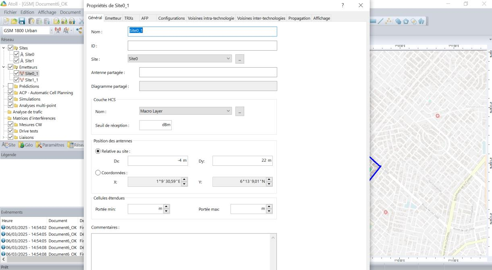
*Figure 12 — Configuration des antennes (1/5) : paramètres généraux*

#### Paramètres de la station de base

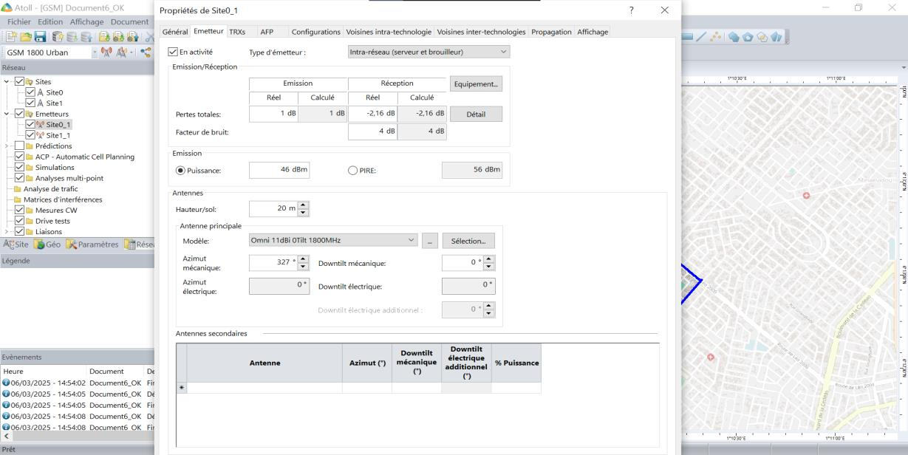
*Figure 13 — Configuration des antennes (2/5) : paramètres de la station de base (onglet Émetteur)*

| Paramètre | Valeur |
|---|---|
| Puissance | 46 dBm (PIRE : 56 dBm) |
| Hauteur / sol | 20 m |
| Modèle d'antenne | Omni 11 dBi 0 Tilt 1800 MHz |
| Azimut mécanique | 327° |
| Pertes totales en émission | 1 dB |
| Pertes totales en réception | −2,16 dB |
| Facteur de bruit | 4 dB |

La section **Émission/Réception** concerne la station de base :

- **Pertes en émission** : pertes entre l'émetteur (BTS) et l'antenne, avant que le signal ne soit réellement émis.
- **Pertes en réception** : pertes entre l'antenne et le récepteur de la BTS lorsque le signal provient d'un mobile.
- **Facteur de bruit** : dégradation du signal due aux composants électroniques du récepteur, définie à **4 dB**.

Les valeurs réelles des pertes n'étant pas connues, les équipements ont été paramétrés avec des valeurs moyennes d'environ 1 dB (atténuation dans les câbles, connecteurs et autres facteurs extérieurs) :

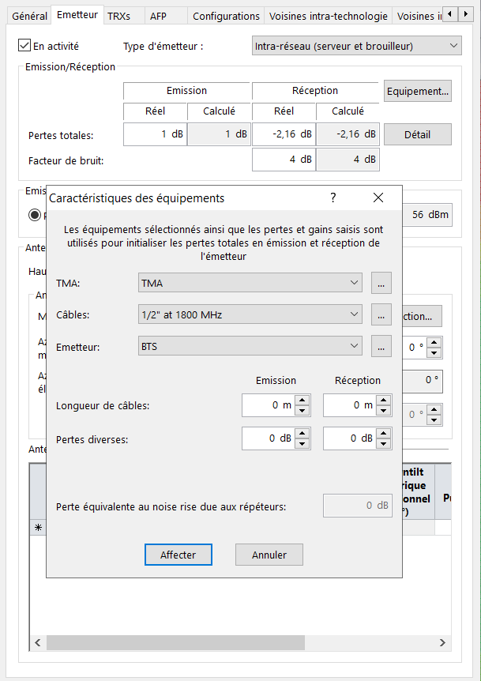
*Figure 14 — Configuration des antennes (3/5) : caractéristiques des équipements (TMA, câbles 1/2" à 1800 MHz, BTS)*

#### Section antenne

- La case **Modèle** définit la fréquence, l'ouverture, le gain et le tilt (inclinaison verticale) de l'antenne.
- Le nombre de ports de connexion antenne ↔ BTS est de **1** en émission et **1** en réception.

#### Modèle de propagation

Dans l'onglet **Propagation**, le modèle choisi est **Okumura-Hata**, adapté aux zones urbaines. Un modèle de propagation est une formule ou un algorithme qui prédit la façon dont les ondes radio se propagent dans un environnement donné.

- **Rayon** : étendue de la zone calculée autour de l'antenne
- **Résolution** : taille des « pixels » utilisés dans les calculs, qui détermine la précision de la simulation

| Émetteur | Modèle | Rayon | Résolution |
|---|---|---|---|
| `Site0_1` | Okumura-Hata | 1 800 m | 50 m |
| `Site1_1` | Okumura-Hata | 2 800 m | 50 m |

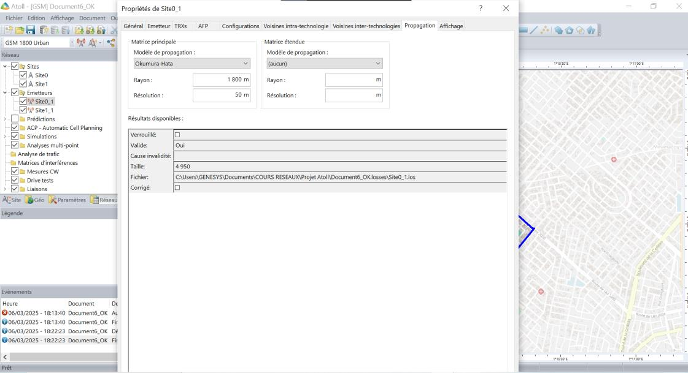
*Figure 15 — Configuration des antennes (4/5) : onglet Propagation*

La configuration du `Site1_1` est identique, à l'exception du rayon de couverture (2 800 m). Résultat obtenu après toutes les configurations :

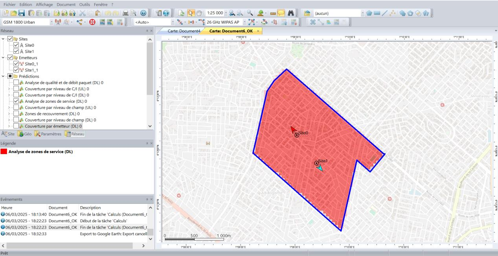
*Figure 16 — Configuration des antennes (5/5) : résultat après configuration*

---

## 5. Prédictions et interprétation des résultats

Une **prédiction** simule et anticipe la couverture et la qualité du réseau en fonction des paramètres de propagation et des caractéristiques des sites radio. Elle donne une idée des ajustements, du déploiement ou de l'implémentation en conditions réelles.

Quatre prédictions essentielles de la planification radio ont été réalisées :

| Prédiction | Rôle |
|---|---|
| **Couverture par émetteur** | Zone géographique couverte par chaque BTS et niveaux de superposition des signaux |
| **Couverture par niveau de champ** | Force du signal reçu dans les différentes zones |
| **Analyse des zones brouillées** | Zones affectées par du brouillage ou des interférences |
| **Analyse des zones de service (rapport signal/bruit, DL)** | Qualité de service en downlink |

### Critères d'interprétation

| Paramètre | Technologie | Valeur acceptable | Bonne valeur | Excellente valeur | Actions correctives |
|---|---|---|---|---|---|
| **Couverture par émetteur** | — | Pas de trous de couverture, chevauchements modérés | | | Ajouter des sites, ajuster les antennes |
| **Niveau de champ (UL et DL)** | GSM | ≥ −105 dBm | ≥ −85 dBm | ≥ −70 dBm | Ajuster la puissance, l'antenne |
| **Niveau de champ C/I (UL et DL)** | GSM | ≥ 18 dB | ≥ 9 dB | ≥ −3 dB | Réduire les interférences, ajuster l'antenne |
| **Zones de service (DL)** | GSM | ≥ 5 dB | ≥ 7 dB | ≥ 9 dB | Augmenter la puissance, réduire les interférences |

### 5.1 Couverture par émetteur

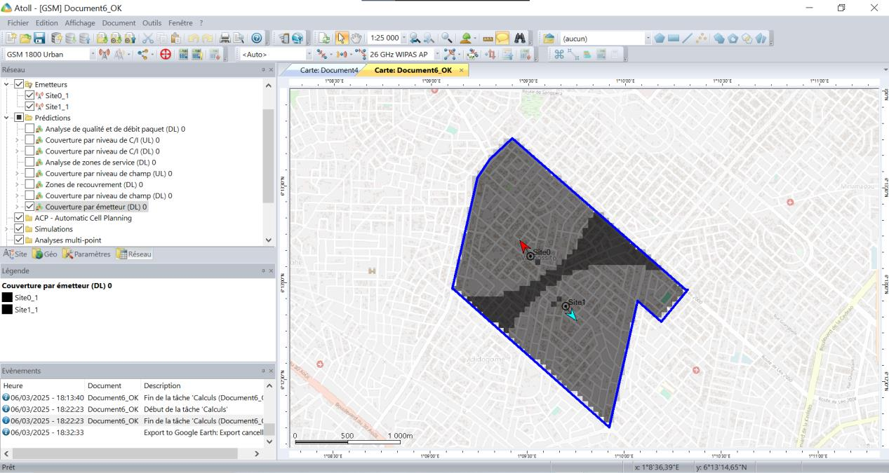
*Figure 17 — Couverture par émetteur*

**Interprétation :** toute la zone est couverte, mais on observe un **chevauchement** entre les deux émetteurs. Pour le corriger, il faudrait ajuster les sites.

### 5.2 Couverture par niveau de champ

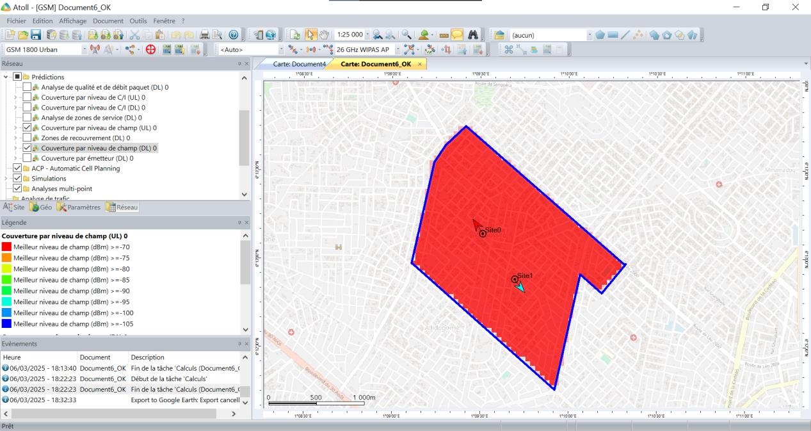
*Figure 18 — Couverture par niveau de champ*

**Interprétation :** la zone apparaît en rouge, avec un signal **≥ −70 dBm**, ce qui correspond à une **excellente couverture** par niveau de champ.

### 5.3 Analyse des zones brouillées

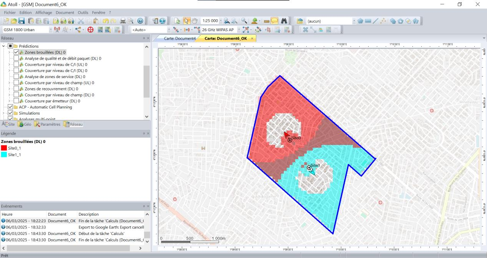
*Figure 19 — Analyse des zones brouillées*

**Interprétation :** la simulation présente **deux zones de brouillage**, de chaque côté des antennes.

### 5.4 Analyse des zones de service (rapport signal/bruit, DL)

*Figure 20 — Analyse des zones de service*

**Interprétation :** la zone rouge est complètement couverte par les deux antennes, ce qui traduit une **excellente qualité de service**.

### 5.5 Simulation du trafic

La simulation de trafic permet d'évaluer la capacité du réseau en fonction de la charge des utilisateurs, de prévoir la qualité de service (QoS) et de juger l'efficacité du dimensionnement.

#### Première simulation — états d'activité

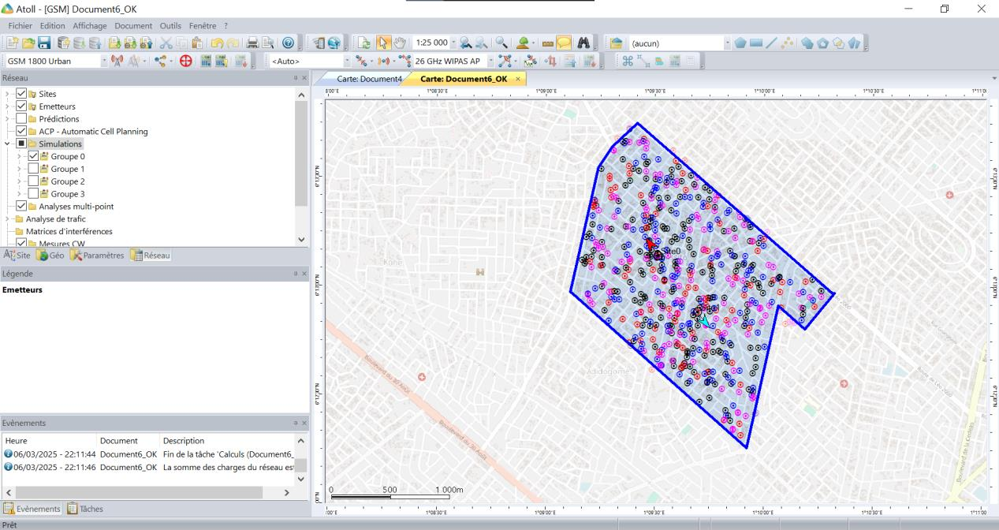
*Figure 21 — Simulation de trafic (états d'activité)*

| Couleur | Signification |
|---|---|
| ⚫ Noir | Utilisateurs non connectés |
| 🔴 Rouge | Connectés à la fois en uplink et en downlink |
| 🔵 Bleu | Connectés uniquement en uplink |
| 🩷 Rose | Connectés uniquement en downlink |

#### Deuxième simulation — états de connexion

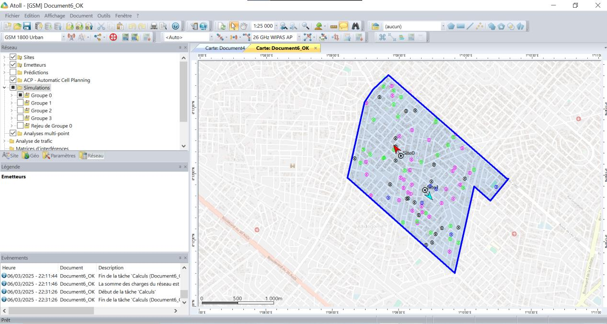
*Figure 22 — Deuxième simulation (états de connexion)*

| Couleur | Signification |
|---|---|
| 🔵 Bleu | Connectés à la fois en uplink et en downlink |
| 🟢 Vert | Connectés soit en uplink, soit en downlink |
| ⚫ Noir | Toujours inactifs |
| 🩷 Rose | Saturation de ressources |

### 5.6 Analyse ponctuelle

L'outil d'**analyse ponctuelle** d'Atoll permet de visualiser le comportement du signal en fonction de la position (et donc de la mobilité) de l'utilisateur. Contrairement à une simulation globale, il se concentre sur des emplacements précis pour fournir des résultats détaillés.

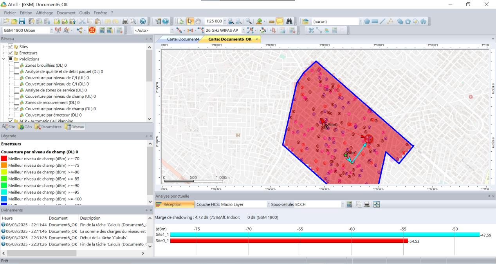
*Figure 23 — Analyse ponctuelle*

**Interprétation :** plus l'utilisateur se rapproche de la zone couverte par une antenne, plus la puissance du signal reçu de cette antenne augmente. En s'éloignant et en entrant dans la zone d'une autre antenne, le nombre de signaux reçus augmente selon le nombre d'antennes situées autour de lui.

---

## 6. Conclusion

La simulation est essentielle pour la planification et l'optimisation des réseaux : elle permet d'évaluer la **couverture**, la **capacité** et la **qualité de service** avant le déploiement. Grâce aux prédictions de niveau de champ, d'interférences et de trafic, on peut anticiper les congestions et améliorer les performances du réseau pour garantir une meilleure expérience utilisateur. Atoll apparaît ainsi comme un outil clé pour concevoir des réseaux mobiles efficaces et fiables.

### Pistes d'amélioration identifiées

- Corriger le **chevauchement** entre `Site0_1` et `Site1_1` en ajustant les sites et les antennes (azimut, tilt, puissance).
- Réduire les **zones de brouillage** observées de part et d'autre des antennes.
- Analyser la **saturation de ressources** visible dans la simulation de trafic.

---

## 7. Références

1. Simbase — <https://fr.simbase.com/iot-glossary-dictionary/umts> (consulté le 06/02/2025)
2. FOAD (UADB) — *Chapitre 3 : Troisième génération* — <http://www.foad.uadb.edu.sn/pluginfile.php/127404/mod_resource/content/7/Chapitre%203%20-%20Troisi%C3%A8me%20G%C3%A9n%C3%A9ration.pdf> (consulté le 06/02/2025)
3. Forsk — *Atoll Overview* — <https://www.forsk.com/atoll-overview> (consulté le 25/01/2025)
4. Atoll User Manual (1library) — <https://node1.123dok.com/dt01pdf/123dok_us/004/598/4598188.pdf.pdf> (consulté le 07/02/2025)

---

## 8. Liste des figures

| N° | Titre | Fichier |
|---|---|---|
| 1 | Zone d'étude (Google My Maps) | `images/figure-01.jpg` |
| 2 | Création du projet dans Atoll | `images/figure-02.jpg` |
| 3 | Système de coordonnées (1/2) | `images/figure-03.jpg` |
| 4 | Système de coordonnées (2/2) | `images/figure-04.jpg` |
| 5 | Importation de la carte (1/2) | `images/figure-05.jpg` |
| 6 | Importation de la carte (2/2) | `images/figure-06.jpg` |
| 7 | Délimitation de la zone concernée | `images/figure-07.jpg` |
| 8 | Positionnement du Site 0 | `images/figure-08.jpg` |
| 9 | Positionnement du Site 1 | `images/figure-09.jpg` |
| 10 | Support des sites 0 & 1 | `images/figure-10.png` |
| 11 | Vue définitive des sites | `images/figure-11.jpg` |
| 12 | Configuration des antennes (1/5) | `images/figure-12.jpg` |
| 13 | Configuration des antennes (2/5) | `images/figure-13.jpg` |
| 14 | Configuration des antennes (3/5) | `images/figure-14.png` |
| 15 | Configuration des antennes (4/5) | `images/figure-15.jpg` |
| 16 | Configuration des antennes (5/5) | `images/figure-16.jpg` |
| 17 | Couverture par émetteur | `images/figure-17.jpg` |
| 18 | Couverture par niveau de champ | `images/figure-18.jpg` |
| 19 | Analyse des zones brouillées | `images/figure-19.jpg` |
| 20 | Analyse des zones de service | `images/figure-20.jpg` |
| 21 | Simulation de trafic | `images/figure-21.jpg` |
| 22 | Deuxième simulation | `images/figure-22.jpg` |
| 23 | Analyse ponctuelle | `images/figure-23.jpg` |
